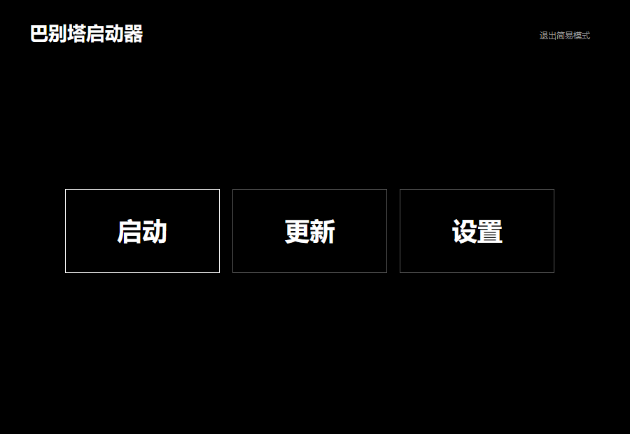

# BabelTowerLauncher — 巴别塔启动器 1.6

用于 [Babel Tower](https://github.com/c1375rick/BabelTower) Deadlock 聊天翻译 Mod 的 Windows 启动与更新管理器。启动器独立维护，Mod 本体由原作者维护。

完整模式采用等高线动态背景，支持深浅色切换，集中展示启动检查、Mod 更新、诊断与修复。


## 使用

下载 `BabelTowerLauncher-1.6-win64.zip`，完整解压后运行“巴别塔启动器.exe”，保留 assets 和 tools。

- 启动前检查所选桥、本地服务、翻译接口与 Mod 文件，通过后确认进入游戏。
- 更新页顶部保留“Mod 更新 / 启动器更新”，下面只有一个“检查更新”按钮；发现新版后变为“下载并安装”。已移除手动压缩包导入区。
- 设置中自动检测或选择路径。已有完整 Mod 可选择已有版本文件夹；未安装时在更新页下载官方完整包。
- 保留一键修复、脱敏报告、启动更新提醒、游戏运行时延后安装及失败恢复。

需要 Windows x64、.NET Framework 4.8 和 Microsoft Edge WebView2 Runtime。不含 Mod 本体和个人配置。

## 简易模式（可切换）

首次打开默认进入纯黑简易模式，主菜单只有“启动、更新、设置”。点击右上角“退出简易模式”即可进入上图的完整界面；完整界面中的“简易模式”可切回来，并记住本地选择。



## 默认模式与配置

发布包不包含 data、安装路径、账号、接口配置或作者的模式选择。新用户没有本地模式记录时默认简易模式；升级保留已有 data 和用户选择。完整界面支持深浅色与等高线背景，简易模式始终纯黑且不创建三维场景。

## 构建与测试

```powershell
powershell -NoProfile -ExecutionPolicy Bypass -File scripts\restore-webview.ps1
cd web
npm ci
npm test
npm run build
cd ..
powershell -NoProfile -ExecutionPolicy Bypass -File scripts\build.ps1
powershell -NoProfile -ExecutionPolicy Bypass -File scripts\test.ps1
powershell -NoProfile -ExecutionPolicy Bypass -File scripts\test-simple.ps1
```

构建产物位于 dist/BabelTowerLauncher-1.6。测试使用隔离数据、模拟服务和屏幕外窗口，不启动真实游戏或所选桥。

## 许可与文档

- [使用说明](docs/ONLINE_UPDATES.md)
- [已知限制](docs/KNOWN_ISSUES.md)
- [实现与验证](docs/IMPLEMENTATION_NOTES.md)
- [GitHub 上传](docs/GITHUB_UPLOAD.md)
- [第三方组件](docs/THIRD_PARTY.md)

启动器采用 [MIT](LICENSE)。第三方许可、MiSans 和 7-Zip 对应源码保留；本项目使用 AI 辅助开发。
